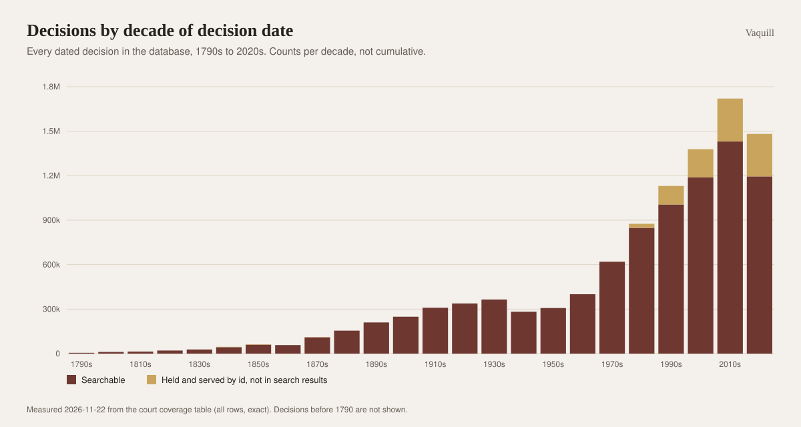
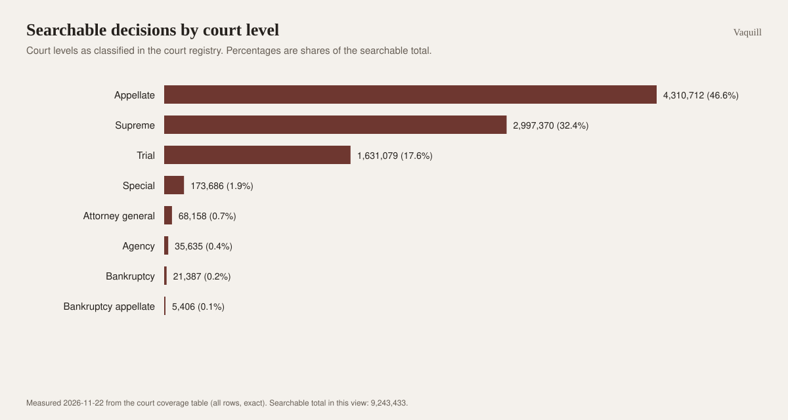
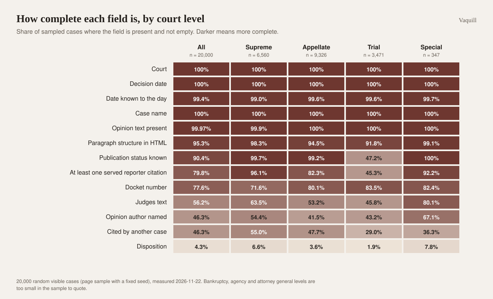
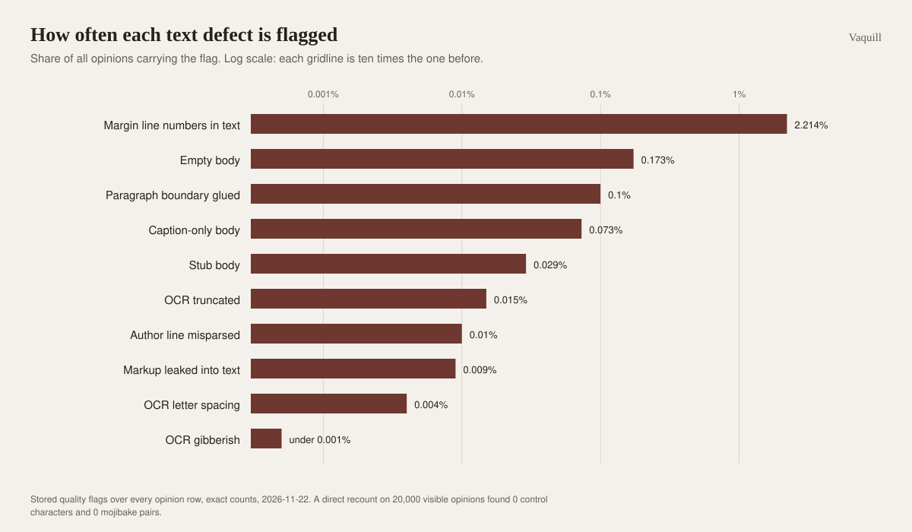
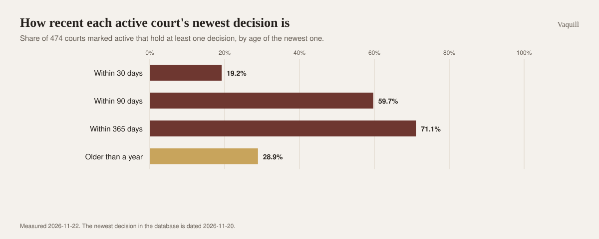

This page states what we measured in the US case law data, how we measured it, and which response fields let you check any single record yourself.
Every figure has a sample size, a date and a method.
Where a figure is a rate over a random sample, the sample is named, so you can draw your own.

Live totals and the list of courts are on the [case law coverage](/api-guide/coverage/case-law) page.
Counts there move as collectors run.
The figures here are a dated measurement, taken on **2026-11-22**.

## What we measure

The data is built to be a base for pipelines, so we measure four things a pipeline depends on.

| Property | The question it answers | Where it shows up in the API |
|---|---|---|
| Completeness | Is the field there when I need it? | The field is present and non-empty |
| Text integrity | Is the opinion text whole and readable? | `qualityFlags`, `textFromOcr`, `bodyUnavailable` |
| Citation graph | Can I follow the law from one decision to the next? | `citations`, `citedByCount`, `GET /us/cases/{caseId}/citations` |
| Provenance | Can I tell where a value came from and when it changed? | `firstSeenAt`, `sourcePublishedDate`, `decisionDatePrecision`, `GET /us/cases/changes` |

## How the figures were taken

| Item | Method |
|---|---|
| Visible records | A record is visible when search and list routes serve it. Every rate below is over visible records. |
| Random samples | 20,000 visible cases, 20,000 visible opinions and 20,000 visible dockets. Rows were drawn by page sampling with a fixed seed, then shuffled. |
| Whole-table counts | Exact counts over every row, not samples. They are marked "all rows". |
| Dates | All figures were measured on 2026-11-22 against the production database in a read-only session. |
| Precision | Page sampling is clustered, so a sample is not a perfectly independent draw. Treat a rate as accurate to about a point, and a level with fewer than 100 sampled cases as a direction only. |

## Scale and shape

The database holds decisions from the 1600s to the present across federal, state, territorial, tribal and military courts.
The decade chart shows every dated decision, split into those that search returns and those that are held and served by id.



Court level comes from the court registry, so it is the same value you filter on with `courtLevel`.



Appellate and supreme courts hold most of the corpus.
Trial court decisions are a smaller share of what is searchable.

## Field completeness

The next chart reads across court levels, because completeness depends heavily on the court.
A supreme court publishes a reporter citation for nearly every opinion.
A trial court usually does not.



Rates over 20,000 random visible cases:

| Field | All | Supreme | Appellate | Trial |
|---|---:|---:|---:|---:|
| Court | 100.0% | 100.0% | 100.0% | 100.0% |
| Decision date | 100.0% | 100.0% | 100.0% | 100.0% |
| Decision date known to the day | 99.4% | 99.0% | 99.6% | 99.6% |
| Case name | 100.0% | 100.0% | 100.0% | 100.0% |
| Full case name | 71.8% | 88.2% | 67.3% | 50.9% |
| Docket number | 77.6% | 71.6% | 80.1% | 83.5% |
| At least one reporter citation served | 79.8% | 96.1% | 82.3% | 45.3% |
| Judges text | 56.2% | 63.5% | 53.2% | 45.8% |
| Opinion author | 46.3% | 54.4% | 41.5% | 43.2% |
| Counsel | 49.8% | 61.6% | 45.5% | 39.3% |
| Publication status known | 90.4% | 99.7% | 99.2% | 47.2% |
| Opinion text present | 99.97% | 99.9% | 100.0% | 100.0% |
| Text with paragraph structure | 95.3% | 98.3% | 94.5% | 91.8% |
| Cited by at least one other case | 46.3% | 55.0% | 47.7% | 29.0% |

Some fields exist only where the court writes them.
Headmatter is present on 21.6% of cases, a syllabus on 2.5%, a summary on 13.4%, a posture on 7.1%, and a raw disposition on 4.3%.
`outcome` is computed from the disposition text, so it is present on the same 4.3%.
Filter on `outcome` knowing it covers a minority of decisions.

Opinions are measured separately, over 20,000 random visible opinions.
Text is present on 99.9%.
The median opinion is about 5,300 characters, and 90% are under about 26,700 characters.
The median opinion is about 900 words.

Dockets, over 20,000 random visible dockets: docket number 90.8%, case name 99.4%, date filed 74.5%, date terminated 57.6%, nature of suit 29.6%.

## Text integrity

Every opinion is checked by detectors that look for specific defects, and a record that fails a check carries a `qualityFlags` entry.
A flag has a `code`, a `severity` and a `detectorVersion`.
Codes are stable: a code is never renamed.

| Severity | Meaning |
|---|---|
| `info` | Worth knowing. The text is usable. |
| `warn` | A defect that may affect use. The text is served. |
| `block` | The text is withheld and `bodyUnavailable` is true. |



Share of all stored opinions carrying each flag, counted exactly over every row:

| Flag | Severity | Share of opinions |
|---|---|---:|
| `pleading_line_numbers` (margin numbers in the text) | warn | 2.2% |
| `empty_body` | block | 0.17% |
| `glued_block_boundary` | warn | 0.10% |
| `caption_only_body` | block | 0.07% |
| `stub_body` | block | 0.03% |
| `ocr_truncated` | warn | 0.015% |
| `error_body` | block | 0.015% |
| `glyph_shift` | block, warn | 0.013% |
| `ocr_control_chars` | warn | 0.002% |
| `ocr_gibberish` | warn | 0.001% |

An independent recount on the 20,000 sampled opinions found no raw control characters in the text or html, and no mojibake pairs.
Three opinions held a Unicode replacement character, 0.015%.

OCR is a fact about the source, and we report it.
`textFromOcr` is true on 47.9% of sampled opinions.
Where the text is OCR, the OCR detectors above are the check on it.

## The citation graph

The graph links opinions to the opinions they cite, inside the corpus.

| Measure | Value | Sample |
|---|---|---|
| Opinions with at least one outgoing citation to a held opinion | 68.4% | 20,000 opinions |
| Outgoing citations per opinion | mean 7.0, median 3, 90th percentile 19 | 20,000 opinions |
| Cases cited by at least one other case | 46.3% | 20,000 cases |
| Cases with two or more reporter citations | 39.0% | 20,000 cases |
| Reporters seen across those citations | 466 | 20,000 cases |

`citedByCount` is the number of distinct other cases that cite one of the case's opinions.
It counts only citations that resolve to a case we hold.
That makes it a floor for the true count, and it grows as coverage grows.

As a plausibility check, the ten most cited cases in the database are all US Supreme Court decisions on the doctrines you would expect: civil pleading, summary judgment, ineffective assistance, habeas, section 1983 and Miranda.
Ashcroft v. Iqbal and Bell Atlantic v. Twombly head the list.

Reporter citations are a union.
A citation from one source is added to those from another and is never removed or replaced.

## Provenance and change tracking

Each field has a ranked source order, so a weaker source cannot overwrite a stronger one.
For the text body the order is the court's own site, then government publishing, then the open scraper library, then docket feeds, then the bulk compilation.
A stronger source replaces a body only when its text is at least as long, so a re-collect cannot shorten an opinion.

Fields that tell you about a record's history:

| Field | What it tells you |
|---|---|
| `decisionDatePrecision` | Whether `decisionDate` is known to the day, month or year. |
| `firstSeenAt` | When we first collected the record, when a collector found it. |
| `sourcePublishedDate` | The date the source published it, when that differs from the decision date. |
| `addedAt`, `updatedAt` | When the record entered and when it last changed here. |
| `citeable` | Whether a recorded court rule lets a lawyer cite this kind of decision. Guidance, not advice. |
| `qualityFlags` | The checks the record failed, if any. |

Changes are listed on `GET /us/cases/changes`, with `upsert` and `removed` events and a cursor.
A record we withdraw appears as `removed`, so a local copy can drop it.
See the [change feed](/api-guide/case-law-change-feed).

## Check it yourself

You do not need to take these figures on trust.
Pull a random sample and count.

```bash
curl -X POST https://api.vaquill.ai/api/v1/us/cases/search \
  -H "Authorization: Bearer vq_key_..." \
  -H "Content-Type: application/json" \
  -d '{"query": "summary judgment standard", "courtLevel": "appellate", "limit": 20}'
```

For each `case` in the response, read the fields in the table above and any `qualityFlags`.
Fetch a case with `GET /us/cases/{caseId}`, then its text with `GET /us/opinions/{opinionId}`, and compare it with the court's own copy.
If you find a record that disagrees, send it to us with the `caseId`.

## What this page does not claim

These figures measure completeness, integrity and traceability.
They are not an accuracy audit against each court's own document.
A hand-checked gold set for that comparison is built, and no result from it is published yet.

Other limits, so you can plan around them:

- **Disposition and outcome** are present on a minority of cases, 4.3% of the sample.
- **Docket numbers** are present on 77.6% of cases, and on fewer attorney general opinions.
- **Judge links** are partial. An opinion author is linked to a judge record on 12.5% of opinions.
- **Original files** are stored for a small share of opinions, and the file routes are not enabled.
- **Treatment of a case** (positive or negative) is not served. `citedByCount` is.
- **Recency** differs by court. The figure below is the age of the newest decision in each active court, so a court with no recent published opinions looks old.



## Related

- [Case law coverage](/api-guide/coverage/case-law) for live totals and the court list.
- [Change feed](/api-guide/case-law-change-feed) to keep a local copy in step.
- [Opinion text](/api-guide/case-law-opinions) for formats, footnotes and citation links.
- [Case law search](/api-guide/case-law-search) for the filters named above.
