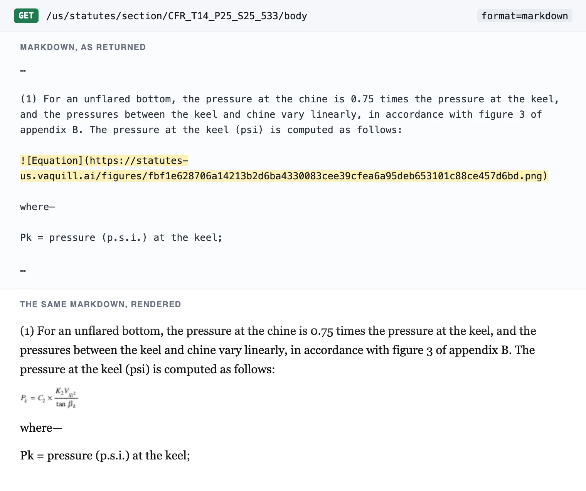
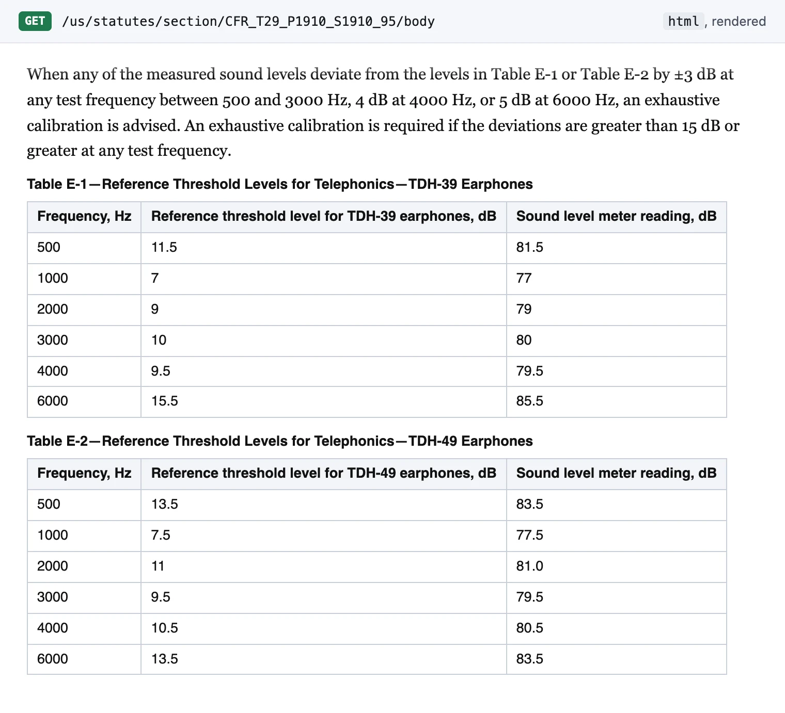

Section bodies keep the publisher's tables, figures, equations and forms.
This page covers where they appear in the response, the fields that describe them and the hosted image files.

<Note>
  Images come back in `html` on the default `format=both`.
  For images in `markdown`, ask for `format=all` or `format=markdown`.
  See [Response formats](/api-guide/concepts/formats) for every `format` value.
</Note>

## Where tables and images appear
When `source` is `r2_render`, the body is a structured rendering of the publisher's document.
Tables and images stay where the publisher printed them, between the paragraphs they belong to, not collected at the end.
In 14 CFR 25.533, for example, each of the three equations follows the sentence that introduces it.

<Frame caption="14 CFR 25.533 with format=markdown: the equation's image link sits between the sentence that introduces it and the definitions that follow, and renders there">
  
</Frame>

Each image appears in every text field you asked for, at the same position:

| Field | An image appears as |
|---|---|
| `html` | A figure or form is `<figure data-figure-id="fig_..."></figure>`, with a `<figcaption>` when the publisher prints a caption. An equation is an inline ``. |
| `markdown` | `` |
| `plain` | A placeholder: `[Figure 1: caption]`, `[Figure 1]` or `[Equation]` |

<Frame caption="COMAR 11.14.07.05: the html field in a browser, with the publisher's figure and its caption between the paragraphs it belongs to">
  
</Frame>

A table is a `<table>` in `html`, a GitHub-flavored pipe table in `markdown`, and tab-separated rows in `plain`.
When the publisher prints a table title, it is the table's `<caption>` in `html`.

<Frame caption="29 CFR 1910.95: two of the section's eleven tables, as the html field renders in a browser">
  
</Frame>

## Image fields

Each entry in `figures` has these fields:

| Field | Contains |
|---|---|
| `figureId` | A stable id, also carried on the `data-figure-id` attribute in `html` |
| `kind` | `figure`, `equation`, `image` or `form` |
| `order` | 1-based position among the section's images |
| `caption` | The publisher's caption, when it prints one |
| `alt` | Alternative text for the image |
| `url` | The hosted image, or `null` when `status` is `unavailable` |
| `sourceUrl` | The image as the government publisher serves it, for a "view at source" link |
| `width`, `height`, `mimeType` | Size and type of the hosted image |
| `offsetMarkdown`, `offsetPlain` | Character offset of the image's position in `markdown` and in `plain` |
| `status` | `hosted` or `unavailable` |

`tables` lists each table's `tableId`, `order`, `caption`, `rows` and `cols`.

## Image files

Images are served from `https://statutes-us.vaquill.ai/figures/` without an API key, so `html` and `markdown` display as they are in a browser or a Markdown renderer.
Loading an image costs no credits.
Formats a browser cannot display (TIFF, EPS, PDF) are converted to PNG.
The file name is the SHA-256 hash of the image, so a URL always returns the same bytes and you can cache it indefinitely.

## When an image or a rendering is missing

- `status: "unavailable"` means the publisher does not serve the image file, so `url` is `null`.
  The image keeps its entry in `figures` and its placeholder in the text.
  This is most common in Code of Federal Regulations annual editions before 2011 and Federal Register documents before 2012, where the government's image server holds no copy.
  `sourceUrl` still records where the publisher would serve the image, and it may not load.
- `figures: []` and `hasFigures: false` mean the section has no images.
- `figures: null` and `hasFigures: null` mean the section has no structured rendering, so its body is returned as text without images. The same holds for `tables` and `hasTables`.
- A rendering is served only while it matches the publisher's current text. When a section changes, the API returns the new text without images until the rendering is rebuilt, never an outdated rendering.

## Coverage

Structured renderings are served for these codes.

| Jurisdiction | Codes with structured renderings |
| --- | --- |
| Federal | Code of Federal Regulations (current and annual editions), Federal Register rules and proposed rules, United States Code, IRS written determinations |
| State regulations | Alabama, Illinois, Indiana, Maryland, Massachusetts, Minnesota, Nevada, Ohio, Washington |
| State statutes | Maine, Minnesota |

In these codes, sections with tables, images or equations come back with `source: "r2_render"`.
Renderings for part of the Alabama, Illinois, Ohio and Washington regulations, the Minnesota statutes and the IRS written determinations are still being built, so some of their sections come back as text for now.

In random samples of sections from the codes below, no section carried a table or an image, so tables there are rare or absent and bodies are text.

| Jurisdiction | Codes where a sample found no tables or images |
| --- | --- |
| State statutes | Arizona, Delaware, District of Columbia, Hawaii, Kansas, Maryland, Massachusetts, Montana, Nevada, North Carolina, Oklahoma, Oregon, Puerto Rico, Rhode Island, South Carolina, South Dakota, Utah, Vermont, West Virginia |
| State regulations | Idaho, Kentucky, Michigan, New Mexico, Wisconsin |

Every other code returns text today, and renderings are being added.
Read `source` and `hasFigures` on each response rather than assuming from the corpus.

## Example

<CodeGroup>

```bash cURL
curl "https://api.vaquill.ai/api/v1/us/statutes/section/CFR_T14_P25_S25_533/body?format=all" \
  -H "Authorization: Bearer vq_key_..."
```

```python Python
import requests

data = requests.get(
    "https://api.vaquill.ai/api/v1/us/statutes/section/CFR_T14_P25_S25_533/body",
    headers={"Authorization": "Bearer vq_key_..."},
    params={"format": "all"},
).json()

if data["source"] == "r2_render":
    for fig in data["figures"] or []:
        if fig["status"] == "hosted":
            print(fig["order"], fig["kind"], fig["url"])
```

</CodeGroup>

The response, shortened:

```json
{
  "actId": "CFR_T14_P25_S25_533",
  "source": "r2_render",
  "hasFigures": true,
  "hasTables": false,
  "markdown": "... The pressure at the keel (psi) is computed as follows:\n\n\n\nwhere ...",
  "plain": "... The pressure at the keel (psi) is computed as follows:\n\n[Equation]\n\nwhere ...",
  "tables": [],
  "figures": [
    {
      "figureId": "fig_f21d1c09bdfc44e8",
      "kind": "equation",
      "caption": "Equation",
      "alt": null,
      "url": "https://statutes-us.vaquill.ai/figures/fbf1e628706a14213b2d6ba4330083cee39cfea6a95deb653101c88ce457d6bd.png",
      "sourceUrl": "https://img.federalregister.gov/EC28SE91.039/EC28SE91.039_original_size.png",
      "width": 77,
      "height": 29,
      "mimeType": "image/png",
      "order": 1,
      "offsetMarkdown": 631,
      "offsetPlain": 628,
      "status": "hosted"
    }
  ]
}
```

The section has two more equations, at later offsets, omitted here.

## Display tables and images

Pick the field that matches what your app shows.

### In a web page: insert `html`

When `source` is `r2_render`, `html` is an HTML fragment with no `<html>`, `<head>` or `<body>` element, so it goes straight into a container.
Its images load from the public image host, so they display with no work on your server.
It carries no styles, so add a few rules for tables, captions and image width.
Sanitize `html` before inserting it, as you would any HTML from outside your app, because for other values of `source` it can be the publisher's own markup.

<CodeGroup>

```js JavaScript
import DOMPurify from "dompurify";

const res = await fetch(
  "https://api.vaquill.ai/api/v1/us/statutes/section/CFR_T29_P1910_S1910_95/body",
  { headers: { Authorization: "Bearer vq_key_..." } },
);
const body = await res.json();

document.querySelector("#section").innerHTML = DOMPurify.sanitize(body.html ?? "");
```

```css CSS
#section img { max-width: 100%; height: auto; }
#section table { border-collapse: collapse; }
#section caption { text-align: left; font-weight: 600; }
#section th, #section td { border: 1px solid #d0d5dd; padding: 4px 8px; vertical-align: top; }
#section figcaption { font-size: 0.875em; color: #555; }
```

</CodeGroup>

Sections without a structured rendering also return `html`, so the same code displays their text.
Hosted images, and the `tables` and `figures` lists, come only with a structured rendering.

### In Markdown: ask for `format=markdown`

Images are standard `` links and tables are GitHub-flavored pipe tables, so any Markdown renderer that supports tables shows the section with its images in place.
A section with no structured rendering returns `plain` instead of `markdown`, so fall back to it.

```python Python
import markdown  # pip install markdown
import requests

body = requests.get(
    "https://api.vaquill.ai/api/v1/us/statutes/section/CFR_T14_P25_S25_533/body",
    headers={"Authorization": "Bearer vq_key_..."},
    params={"format": "markdown"},
).json()

page = markdown.markdown(body["markdown"] or body["plain"] or "", extensions=["tables"])
```

To give a language model the section with its images, send it `markdown`.
Each image is a link at the place it belongs, and a model that reads images can be given the file at `url`.

### As plain text: `plain` and `figures`

`plain` carries no images.
A placeholder such as `[Figure 1]` or `[Equation]` marks where each one goes, and `offsetPlain` in `figures` points at it.
To show the images next to the text, list `figures` and display or link each `url`.

### Keep a copy of the images

Download each hosted image once and keep it.
The file name is the image's SHA-256 hash, so the bytes at a URL never change and the name works as a cache key.
The image host needs no API key.

```python Python
from pathlib import Path

for fig in body["figures"] or []:
    if fig["status"] == "hosted":
        path = Path("figures") / fig["url"].rsplit("/", 1)[1]
        if not path.exists():
            path.parent.mkdir(exist_ok=True)
            path.write_bytes(requests.get(fig["url"], timeout=30).content)
```

## Related

<CardGroup cols={2}>
  <Card title="Response formats" href="/api-guide/concepts/formats">
    Every field the body endpoint returns, and the `format` values.
  </Card>
  <Card title="Section identifiers" href="/api-guide/concepts/section-ids">
    How to get an actId and fetch a section's metadata and body.
  </Card>
</CardGroup>
