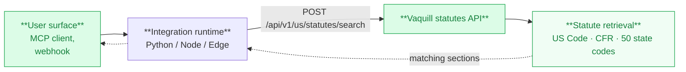

Use Vaquill AI from the tools your team already has open: Claude, ChatGPT, an IDE, a Google Sheet.
The integrations in the GitHub repo are open-source and self-hostable, and all of them call the same [Vaquill statutes API](/api-reference/us-statutes/search-us-statutes-constitutions-court-rules-and-executive-actions).

<CardGroup cols={2}>
  <Card title="MCP Servers" href="/integrations/mcp">
    Connect Vaquill AI's US statute corpus (US Code, CFR, all 50 state codes) to Claude, Cursor, VS Code, or any MCP client.
  </Card>
  <Card title="Automation" href="/integrations/automation/n8n">
    n8n and Make.com templates that read questions from a Google Sheet and write back matching statute sections and citations.
  </Card>
  <Card title="GitHub" href="https://github.com/Vaquill-AI/integrations">
    Every integration is MIT-licensed. Fork what you need.
  </Card>
</CardGroup>

## Pick an integration

| If you want to... | Use |
|---|---|
| Search US statutes from Claude / Cursor / VS Code | [Vaquill MCP](/integrations/mcp/vaquill) |
| Batch-process legal questions from a Google Sheet | [n8n / Make.com](/integrations/automation/n8n) |

## Common architecture

Each integration is a thin wrapper.
It takes input from its surface (an MCP tool call or a webhook), calls the statutes search endpoint, and renders the matching statute sections.

One API key (`vq_key_...`) from your [dashboard](https://app.vaquill.ai/settings) works for all of them, except the Claude connector, which signs in with OAuth instead.
Configuration is through environment variables, and every integration ships with a Dockerfile and at least one cloud-deploy recipe.

## Build your own

To add a surface we do not ship (Slack, Outlook, Notion, a CRM, an internal portal):

1. Generate a key in your [dashboard](https://app.vaquill.ai/settings).
2. `POST /api/v1/us/statutes/search` with `{ "query": "..." }` and `Authorization: Bearer vq_key_...`.
3. Render the returned results (citation, title, excerpt and `actId`).
4. Pass filters (`corpusType`, `state`, `code`) to narrow results.

See [Authentication](/api-guide/authentication) for key setup and [Errors](/api-guide/errors) for status-code handling.
